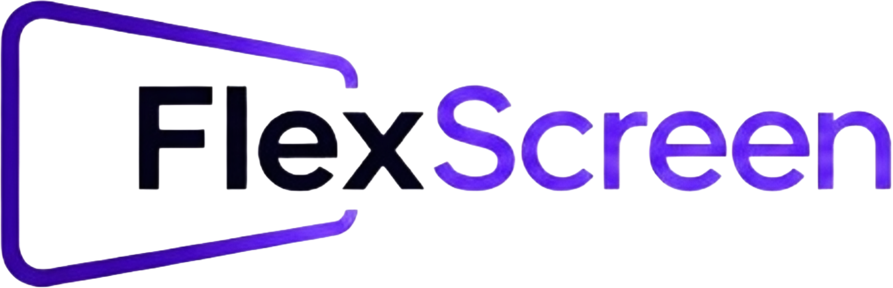
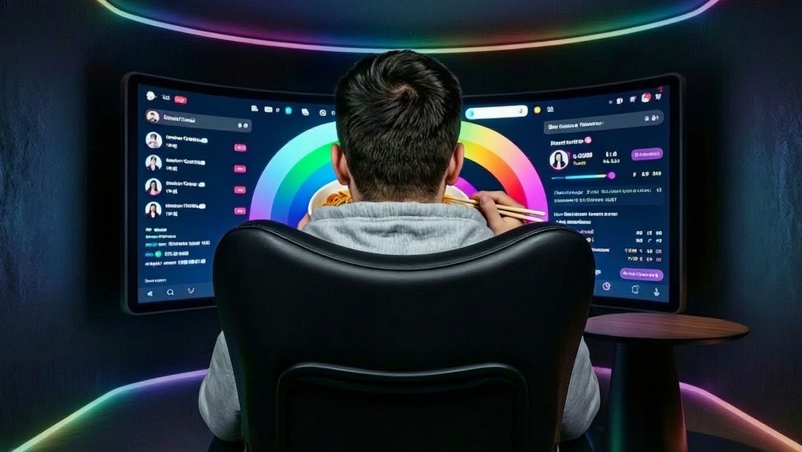
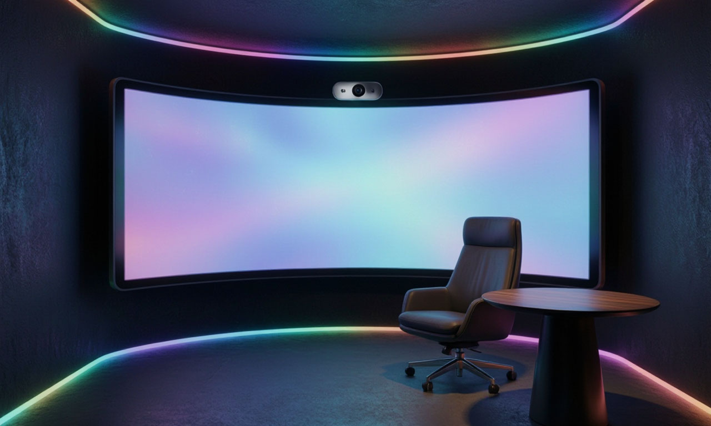

# Гибкие экраны для кафе и ресторанов

Проводите съемки с фудблогерами и получайте нативную рекламу с помощью продвинутого оборудования для контента.

[Узнать цену →](price.md){ .md-button .md-button--primary }

[Характеристики →](specs.md){ .md-button }

=== "Съемка контента в кафе"
    
    *Создайте идеальную зону для проведения стримов фудблогерами!*

=== "Интерьер ресторана с FS-1"
    
    *Гибкий экран гармонично вписывается в любой интерьер и не занимает лишнего места.*

---

## 3 причины выбрать FlexScreen

-   :material-trending-up:{ .lg .middle } **Реальная выгода**

    ---

    Приглашайте блогеров в заведение и получайте органические охваты без затрат на таргетированную рекламу.

-   :material-heart-pulse:{ .lg .middle } **Забота о здоровье**

    ---

    Гибкая конструкция помогает людям с ограничениями по здоровью мягко привыкать к подвижному образу жизни при настройке экрана.

-   :material-video-4k-box:{ .lg .middle } **Премиум-качество**

    ---

    Четкое 4K-изображение и встроенная камера гарантируют студийную картинку для любого видеоролика.

---

## Инновации для активной жизни

Наши экраны разработаны с заботой о людях с проблемами со здоровьем, которым важно постепенно адаптироваться к физической активности. Гибкий корпус обеспечивает удобство в работе и создает мягкую необходимость в движении — экран легко плавно согнуть, разогнуть и настроить под любой ракурс.

[Посмотреть характеристики →](specs.md){ .md-button .md-button--primary }

---

## Контакты и навигация

**Гибкие экраны для вашего бизнеса** — свяжитесь с нами или перейдите в нужный раздел:

* **Телефон:** +7 (495) 123-45-67
* **Email:** [hello@flexscreen.ru](mailto:hello@flexscreen.ru)
* **Адрес шоурума:** г. Москва, ул. Технологическая, д. 1

**Быстрые переходы:** [Прайс-лист и тарифы](price.md) · [Характеристики FS-1](specs.md) · [Документация](docs.md) · [Отзывы рестораторов](reviews.md)

